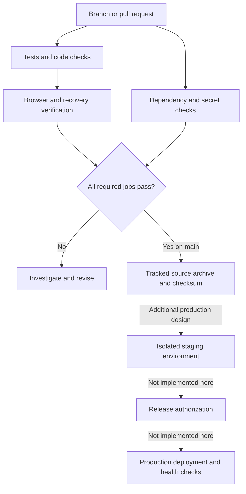

# CI/CD: implementation and reference design

## Public implementation

The portal has a working GitHub Actions definition for configuration checks, tests, linting, static security analysis, dependency auditing, browser verification, recovery verification and secret scanning. A source archive is created only after the required workflow jobs succeed on the default branch. This is artifact delivery, not server deployment.

This documentation repository has its own smaller workflow: local-link and publication checks, checker tests and a full-history secret scan. Run records are available in each repository's Actions tab. The public portal is the concrete implementation example; it does not reproduce private deployment infrastructure.

## Security decisions in the public workflows

1. Use a read-only repository token for build and scan jobs.
2. Pin actions to complete commit hashes. Review updates to those references.
3. Install application and development packages from version-and-hash lockfiles.
4. Keep runtime credentials and databases outside tracked files. Generate disposable test credentials locally or on the runner.
5. Run untrusted contributions through ordinary pull-request workflows, without production secrets or privileged `pull_request_target` execution.
6. Treat an unavailable check as a failed check. Do not silently skip the test suite because a script is missing.
7. Build the source artifact from tracked content only after verification succeeds. Retain it for a short period.

These decisions are consistent with [GitHub's secure-use guidance](https://docs.github.com/en/actions/reference/security/secure-use). Pinning reduces one supply-chain risk; it does not make an action or its downloaded dependencies trustworthy by itself.

## Workflow definitions are not merge protection

The inspected private configuration includes checks with branch filters and optional steps. This matters because a check can exist without executing on the branch being used. A successful run is also different from a required check that prevents a merge. This case study makes no claim about private branch-protection settings.

For the public repositories, consult their verification records for settings actually applied. Required checks should use the job names emitted by real runs, and administrators should understand whether they can bypass them.

## Production deployment: recommendation only

A production pipeline would need a defined hosting target, reviewed environment permissions, short-lived deployment credentials where supported, release authorization, migration and rollback procedures, health checks, monitoring and recovery evidence. None of those product-specific systems are disclosed or claimed here. Packaging a source archive does not establish production readiness.
